# Nitrogen (N2)

Your notes shouldn't live in someone else's database, and they shouldn't be invisible to the AI you already talk to every day. If you think out loud with an assistant, the good stuff (ideas, plans, decisions, open questions) usually scrolls away in a chat you'll never find again.

Nitrogen is where it lands instead: a personal wiki you host yourself on Cloudflare, with a tree of markdown pages, search that finds things by meaning, and a built-in MCP server so your AI assistant can write to it, organize it and pull it back up when you ask. To-dos, questions and reminders live right on the page they belong to and roll up to one list, so nothing you meant to come back to gets lost. Every assistant edit is labelled and can be undone a whole session at a time, so you can hand it real work without wondering what it touched.

It's for people who keep a lot in their heads, talk it through with AI, and want an external memory that's structured, theirs, and easy to revisit later.

[](https://deploy.workers.cloudflare.com/?url=https://github.com/tyler-class/Nitrogen)

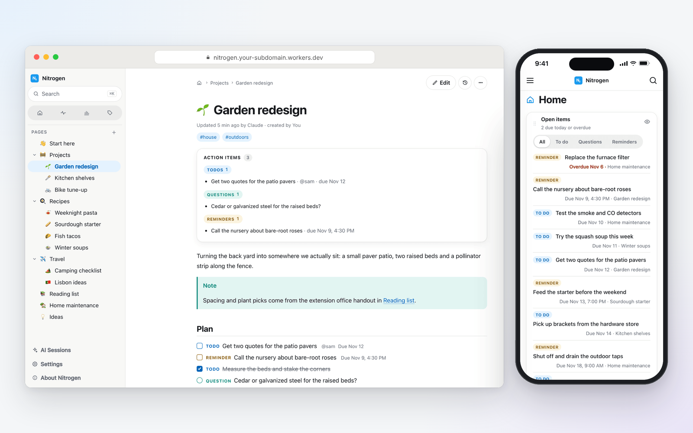

- **A page tree.** Every page can hold subpages. Drag pages in the sidebar to reorder or nest them.
- **Markdown with wiki links.** `[[Page title]]` links pages and powers “Linked from” backlinks.
  Callouts (`> [!TIP]`), tables, task lists and code blocks render cleanly.
- **Images where you put them.** Paste, drop or pick an image in the editor; it uploads to R2 and its
  markdown lands at the cursor.
- **Semantic search.** Find pages by meaning and by keywords (Cloudflare AI Search + D1 full-text).
- **History.** Every page keeps earlier versions, each marked with who wrote it; restore any of them.
- **AI assistants.** A built-in MCP server lets Claude, ChatGPT and other assistants search, read, create, edit
  and reorganize pages. Every edit is labelled with the assistant that made it, and you can undo
  a whole assistant session from the Activity page.
- **Home.** An inbox of what assistants changed since you last looked, open items, pages you pin
  (from a page's ⋯ menu), recent activity and a few numbers. Drag panels to arrange them, make them
  half or full width, or hide them.
- **To-dos, questions and reminders anywhere.** Write `- [ ] todo: … @owner due:2026-11-20`,
  `- question: …` or `- [ ] reminder: … due:…` on any page. Add a 24-hour time to be notified then:
  `due:2026-11-20 14:00` (or `due:2026-11-20T14:00`), on your phone's own clock. They show as cards
  you can check off, a summary at the top of the page, and an Open items panel on Home; assistants
  list them with `open_items`.
- **Sessions.** Every assistant session that changes the wiki is recorded automatically under a
  protected, read-only Sessions section, with the pages it touched and the assistant's own summary.
- **Exports.** A full backup that restores everything, and a Markdown export (per page or the whole
  wiki as a .zip) that downgrades callouts and items to plain text for other apps and Google Docs.
- **Tags and connections.** Tag pages (or write `#tag` in the text), see pages that mention this
  one without linking it and link them in one click, and related pages found by meaning.
- **Insights.** Arrangeable panels like Home: a calendar of edits by you and by assistants, who writes the wiki, what's busiest, what
  needs attention, and what assistants searched for and couldn't find.
- **Yours.** It runs on your Cloudflare account; the free plan is enough for a personal wiki.

**Ask your assistant, typed or out loud.** It works in your wiki for you: updating a plan as you talk it through, summarizing a section with its open items, and adding a reminder you dictate on your phone.

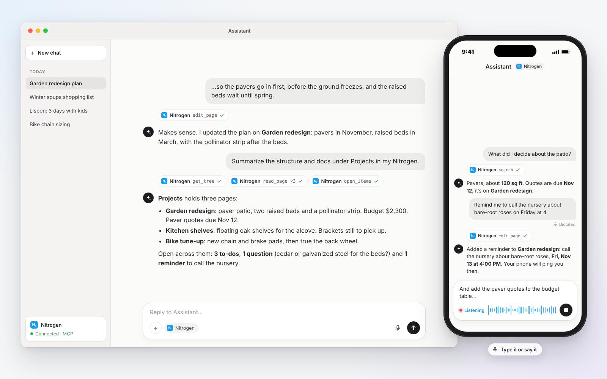

## A look around

**A page:** headings, a table, and to-dos, questions and reminders right in the text.

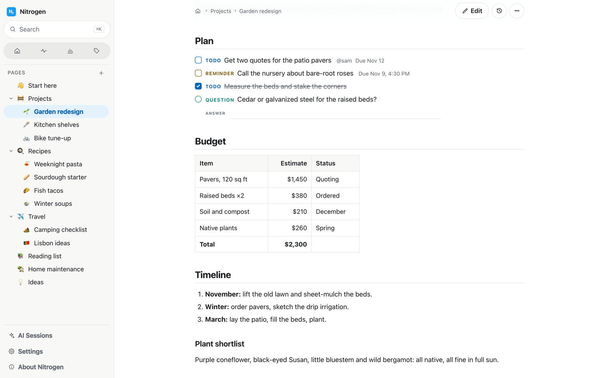

**Editing:** markdown with a toolbar for headings, callouts, diagrams, items and images. Type `[[` to link a page.

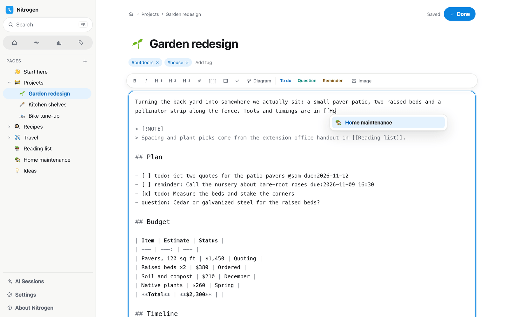

**History:** every earlier version with who wrote it. Compare any two, or restore one.

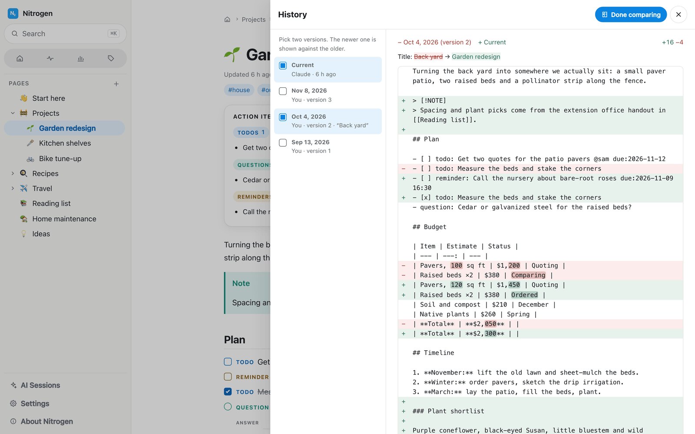

**Connections:** pages inside this one, pages that link here, and pages that mention it without a link yet.

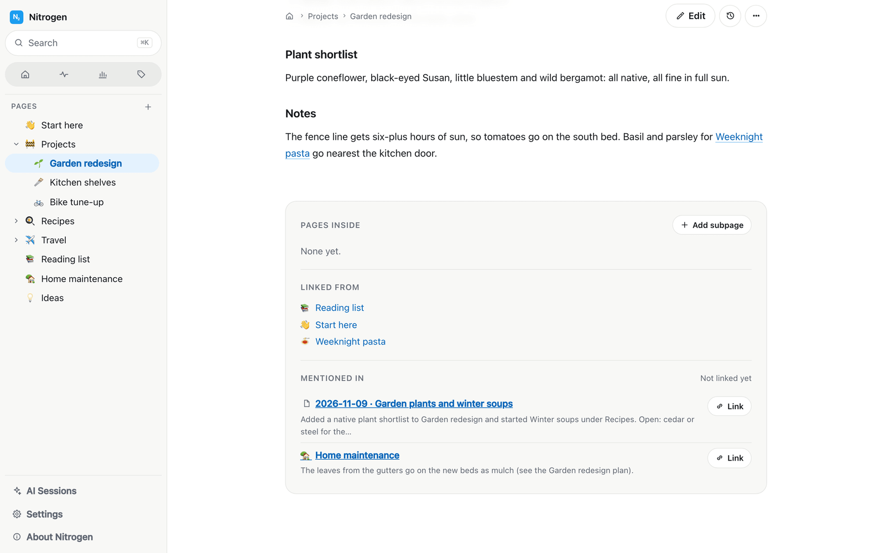

**The page menu (⋯):** pin a page to Home, copy its wiki link, or download it as Markdown.

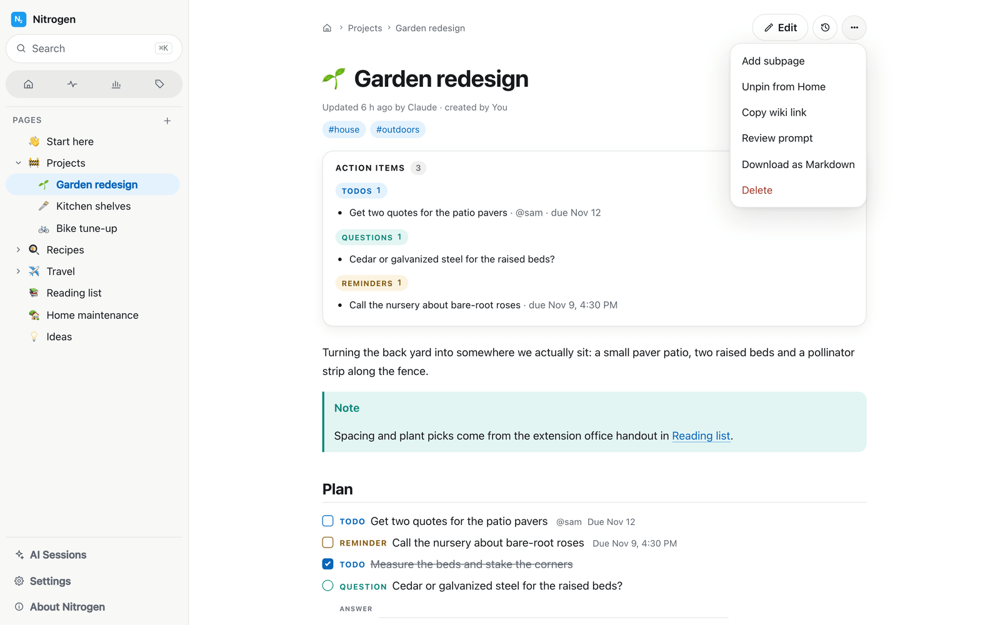

**Search (⌘K):** jump to any page by title or keyword, or press Enter to search by meaning.

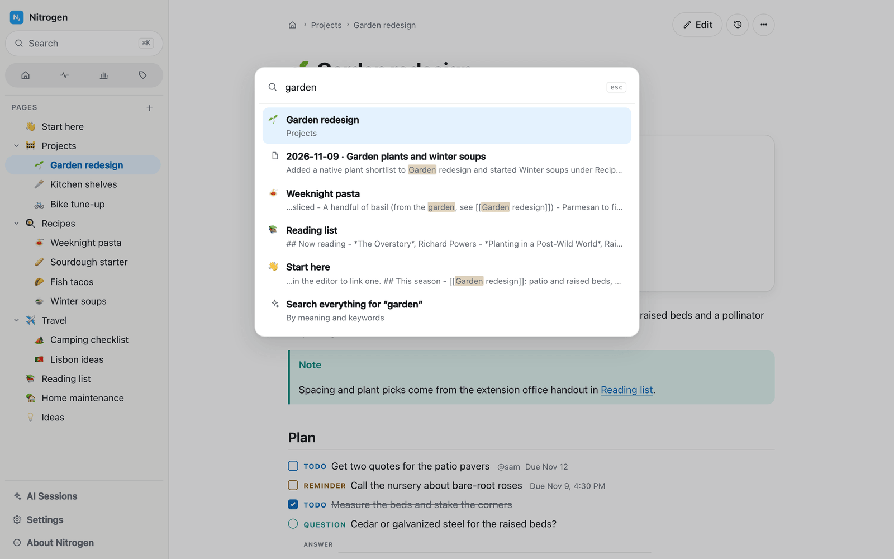

**The Search page:** best match, by meaning, or exact words, with the matching text highlighted.

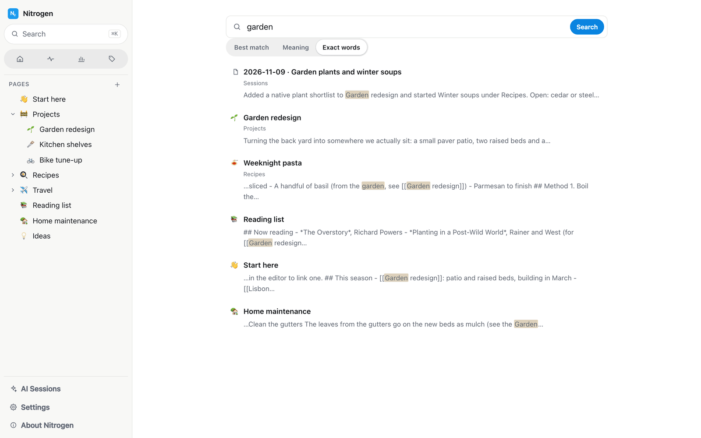

**Tags:** every tag, most used first or A–Z, and the pages under each.

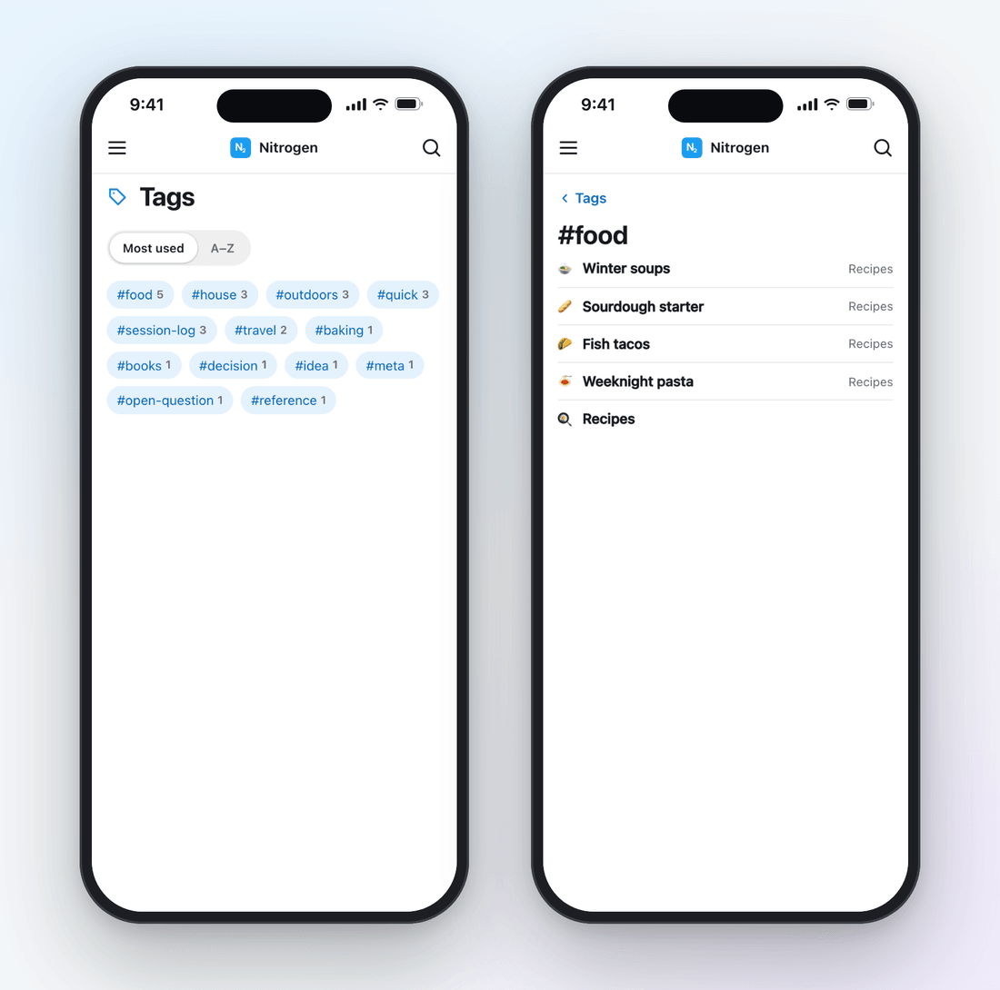

**Activity:** every change, grouped by who made it. Show everyone, only you or only assistants, and undo an assistant's whole session.

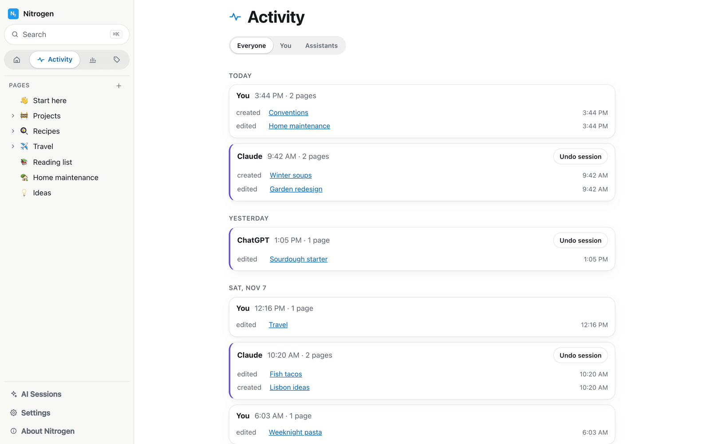

**Insights:** who writes the wiki, when, and what's busiest.

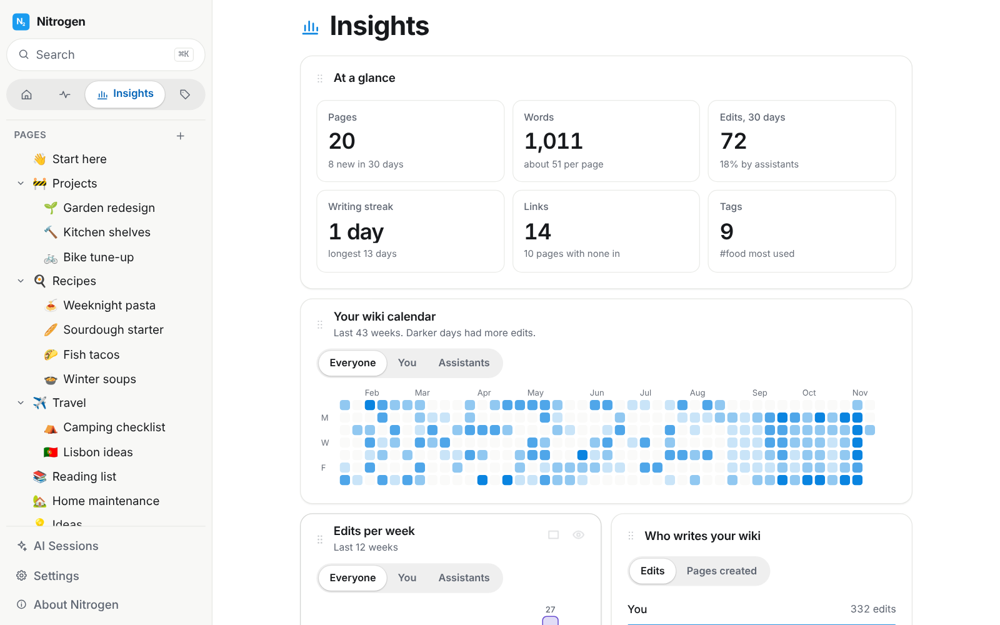

**AI Sessions:** every assistant session that changed the wiki, with its summary.

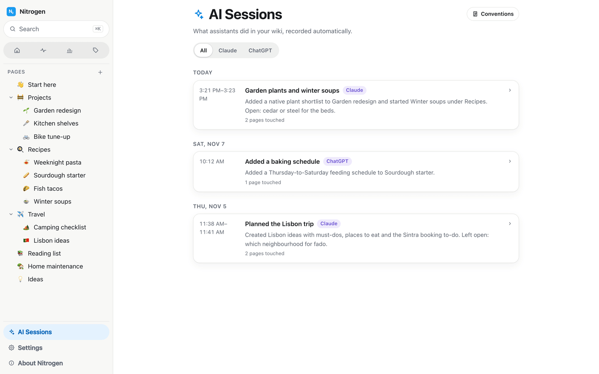

**Conventions:** how you like things filed. Every assistant reads it when it connects.

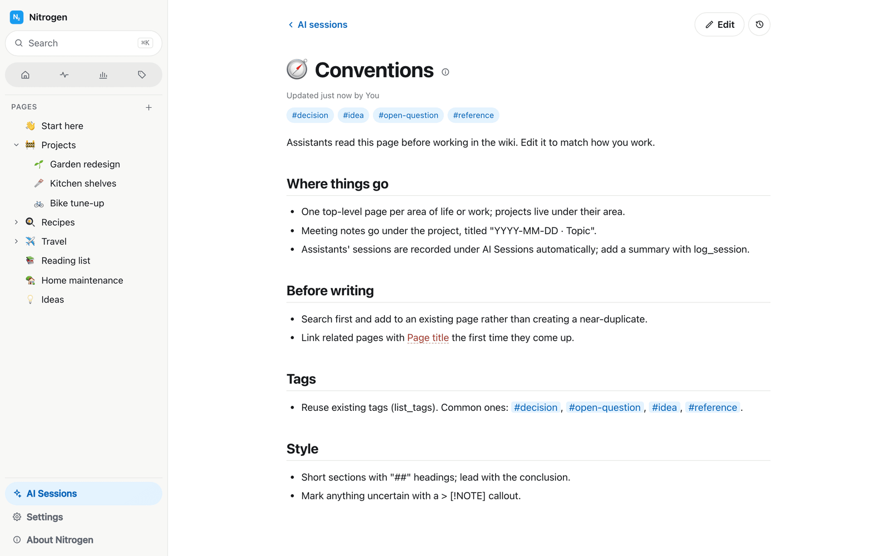

**On your phone:** Home with open items (overdue and timed ones included), the page tree with its emoji, and a page.

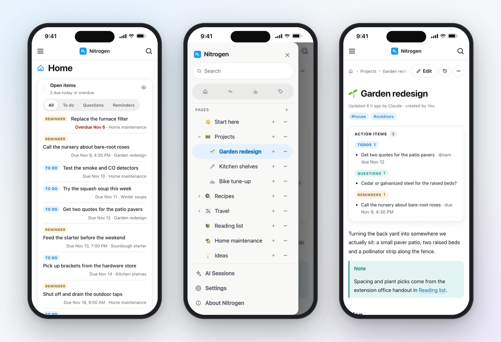

**Dark mode:** follows your device, or pick it in Settings.

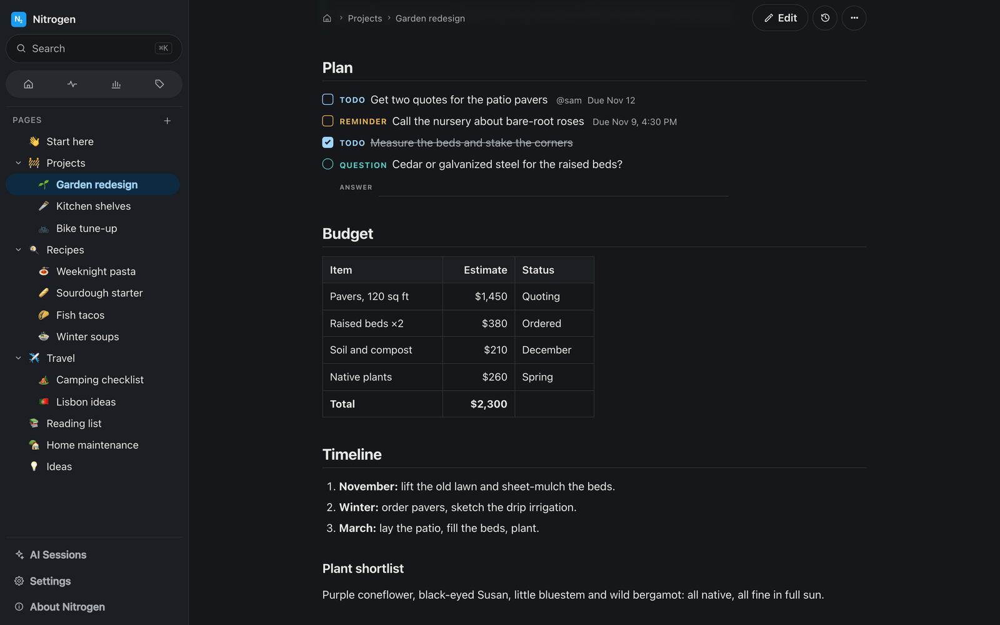

<!-- kit:readme:start -->
<!-- Written by the Selfhost Kit (kit/docs/readme-install.md): edit it there. -->

## Install

You need two free accounts, and about five minutes.

### 1. Have a Cloudflare account

Nitrogen runs on your own Cloudflare account. The free plan is plenty. If you don't have one, [sign up](https://dash.cloudflare.com/sign-up) and confirm your email.

<!-- 📸 SCREENSHOT docs/screenshots/install-1-cloudflare-signup.png: Cloudflare's sign-up page -->

### 2. Have a GitHub account

The Deploy button makes your own copy of Nitrogen's code in your GitHub account, so you can keep it updated. If you don't have one, [sign up](https://github.com/signup).

### 3. Let Cloudflare use your GitHub

Cloudflare needs its **Cloudflare Workers and Pages** app installed on your GitHub account to create your copy and deploy it.

1. Open [github.com/apps/cloudflare-workers-and-pages](https://github.com/apps/cloudflare-workers-and-pages) and click **Install** (or **Configure** if it's already installed).
2. Choose your account.
3. Pick **All repositories**. That's simplest, because the Deploy button creates a new one. If you'd rather limit it, choose **Only select repositories** and come back to add your Nitrogen copy after step 4.
4. Click **Install**.

<!-- 📸 SCREENSHOT docs/screenshots/install-3-github-app.png: GitHub's install page for Cloudflare Workers and Pages, with All repositories selected -->

You can also do this in the middle of the next step: Cloudflare asks you to connect GitHub if you haven't.

### 4. Click Deploy

[](https://deploy.workers.cloudflare.com/?url=https://github.com/tyler-class/Nitrogen)

Sign in to Cloudflare if it asks. You land on a setup page.

<!-- 📸 SCREENSHOT docs/screenshots/install-4-deploy-page.png: Cloudflare's "Create an application" page for Nitrogen -->

### 5. Check the names (most people keep the defaults)

- **Git account**: your GitHub account.
- **Repository name**: what your copy is called on GitHub. Leave **Create private Git repository** ticked to keep it private.
- **Project name**: the Worker's name, which is also in your address: `https://nitrogen.<your-subdomain>.workers.dev`.
- **Database and storage names**: what Cloudflare calls the storage it creates for you. Keep them.

### 6. Set your password

Under **Variables and secrets**, fill in **APP_PASSWORD**: the one password everyone in your household uses to sign in. Pick something long. You can change it later (see [Change your password](#change-your-password)), but set it now.

<!-- 📸 SCREENSHOT docs/screenshots/install-6-password.png: The APP_PASSWORD field on the setup page -->

### 7. Create and deploy

Click **Create and deploy**. Cloudflare copies the code to your GitHub, creates the storage and builds Nitrogen. It takes a minute or two. When the build log finishes, your address is at the end of it, and on the Worker's page under **Domains**.

<!-- 📸 SCREENSHOT docs/screenshots/install-7-build-done.png: A finished build log with the workers.dev address at the end -->

Open it, sign in with your password, and you're done. Bookmark it, or add it to your phone's home screen.

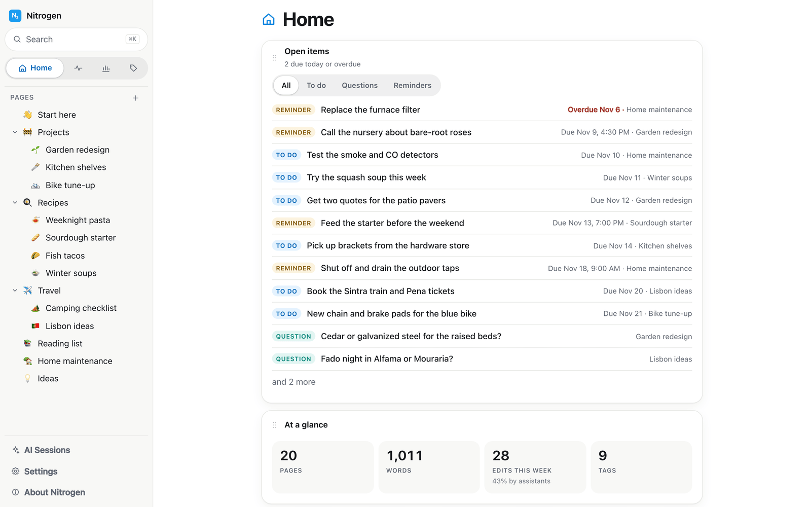

### 8. Set up automatic updates (recommended)

Your copy updates itself every Monday once you allow it. That takes one click, once:

1. In Nitrogen, open **Settings → Updates** and choose **Set up automatic updates**.
2. GitHub opens with the update file filled in. Click **Commit changes**.

That brings in the latest Nitrogen straight away, then every week. See [Updates](#updates) for how it works.

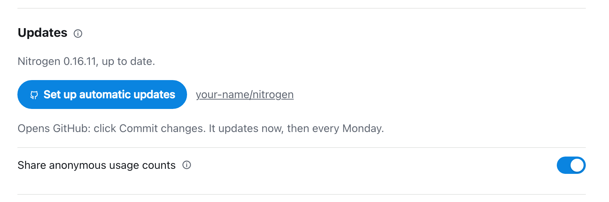
<!-- 📸 SCREENSHOT docs/screenshots/install-8-commit.png: GitHub's new-file page with the update file filled in, and the Commit changes button -->

## Notifications

Nitrogen can send notifications to your phone. They only work in the app installed on your phone (added to your Home Screen), not in a browser tab.

**Install it on iPhone or iPad** (iOS 16.4 or later):

1. Open Nitrogen in Safari and tap **Share**.
2. Tap **Add to Home Screen**, then **Add**.
3. Open Nitrogen from the new Home Screen icon.

**Install it on Android:** open Nitrogen in Chrome, open the menu **⋮** and tap **Install app** (or **Add to Home screen**), then open it from the new icon.

**Turn them on:** in the installed app, open **Settings → Notifications** and switch on **Notifications on this device**. Allow notifications when your phone asks. Each phone chooses its own, so everyone in the family can pick what they get. **Send a test** checks it's working.

## Updates

Updates take two steps, both in your own accounts. Nitrogen never deploys to your Cloudflare directly.

1. **Nitrogen → your GitHub copy.** The update workflow you added in step 8 brings in the latest code every Monday. To update now, open **Settings → Updates → Update now** and click **Run workflow** on GitHub. Settings also tells you when a newer version is out.
2. **Your GitHub copy → your Cloudflare.** Cloudflare builds and deploys every change to your copy, migrating the database first. This was switched on in step 7.

Your data lives in your Cloudflare database and file storage, not in the code, so updates don't touch it. An update replaces the code in your copy, so changes you made to it are overwritten. Your copy's own name and storage settings are kept.

Deployed by hand instead? `git pull`, then `npm run deploy`.

## Change your password

1. In Cloudflare, open **Compute → Workers & Pages** and choose **nitrogen**.
2. Open the **Settings** tab. Under **Variables and Secrets**, find **APP_PASSWORD** (type **Secret**) and click its pencil icon.
3. Type the new password and save. You can't see the current one, only set a new one.

Everyone is signed out and signs in again with the new password.

<!-- 📸 SCREENSHOT docs/screenshots/password-1-secrets.png: The Variables and Secrets list with APP_PASSWORD and its pencil icon -->

## Use your own domain (advanced)

Your address starts as `https://nitrogen.<your-subdomain>.workers.dev`. Two ways to change it:

- **Rename your workers.dev subdomain.** In Cloudflare, open **Compute → Workers & Pages**. Your subdomain is shown on the right, with **Change**. It applies to every Worker in your account, so all your apps move together.
- **Give Nitrogen its own address on a domain you own**, like `nitrogen.example.com`. The domain has to be on Cloudflare. Open the Worker, go to **Settings → Domains & Routes → Add → Custom domain**, and enter the address. Cloudflare sets up DNS and the certificate. Repeat for each app to give each one its own subdomain.

<!-- 📸 SCREENSHOT docs/screenshots/domain-1-custom-domain.png: Settings → Domains & Routes → Add → Custom domain -->

If you connected an AI assistant, connect it again with the new address.

## Anonymous usage counts

Once a day your copy tells Nitrogen's developer that it exists: a random id it made for itself, its version, how many pages, revisions, tags and links it has (counts only), how many files it stores, and whether automatic updates are on. Never names, contents or anything you type, and no IP address is kept. It shows how many copies are in use. Turn it off in **Settings → Updates → Share anonymous usage counts**: your copy sends one last message saying it's off, then nothing.

<!-- kit:readme:end -->

## Which notifications

Turn notifications on as described in [Notifications](#notifications), then pick what this phone gets in **Settings → Notifications**. Each kind has its own switch, all on to start.

- **Morning digest:** at 8 a.m., the to-dos and reminders due that day.
- **Overdue:** at 8 a.m. on the first day a to-do or reminder is overdue, once per item ("Overdue: Renew the domain (due Nov 10)").
- **Timed reminders:** at the time on an item written with one, like `- [ ] reminder: Call the dentist due:2026-11-12 14:00`, within about 15 minutes ("Reminder: Call the dentist (2:00 PM)"). Items without a time are only in the morning digest.
- **Assistant changes:** when an assistant creates or edits pages over MCP, at most once an hour ("Claude updated 3 pages: Trip ideas, Garden, …"). Your own edits never notify, and nothing comes between midnight and 8 a.m.
- **Open questions:** Monday at 8 a.m., the `question:` items still unanswered. Skipped in weeks with none.

Times are your phone's own clock. The app icon shows how many to-dos and reminders are due today or overdue.

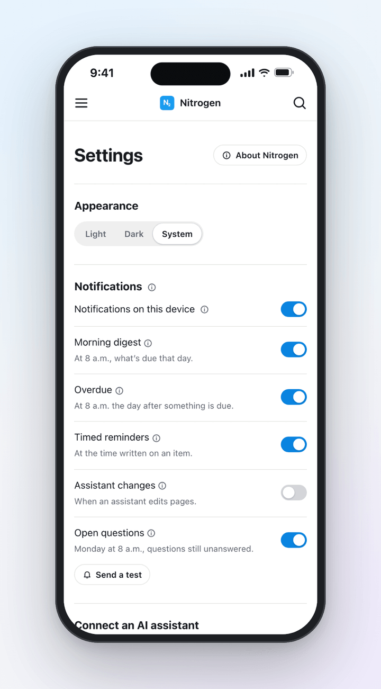

## Use it on your phone

Open your Nitrogen link on the phone, then:

- **iPhone:** in Safari, tap Share, then **Add to Home Screen**.
- **Android:** in Chrome, open the menu and tap **Install app**.

It opens full screen like a regular app.

## Connect Claude

In Nitrogen, open **Settings → Connect an AI assistant** and copy your MCP URL
(`https://<your-nitrogen>/mcp`).

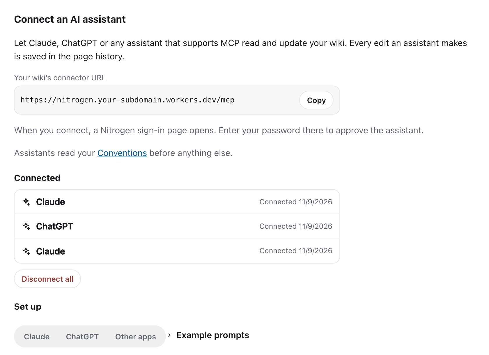

- **Claude (web, desktop, mobile):** Settings → Connectors → Add custom connector → paste the URL.
  Approve with your wiki password.
- **Claude Code:** `claude mcp add --transport http nitrogen https://<your-nitrogen>/mcp`

Tools: `get_tree`, `read_page`, `search`, `create_page`, `create_pages` (a whole subtree at once),
`edit_page` (find/replace, section edits, append), `update_page`, `move_page`, `delete_page`
(confirmed by title), `list_revisions`, `read_revision`, `restore_revision`, `list_tags`,
`tag_page`, `log_session` (adds a title and summary to the assistant’s automatic Sessions entry),
`open_items` (to-dos, questions and reminders across the wiki), `recent_changes` (what changed, grouped by who), `get_started` (the wiki’s state plus
example requests; assistants call it when you ask what they can do), and for images:

- `add_image`: from a public URL or base64 bytes.
- `request_image_upload`: for an image you have, such as one attached in chat (chat attachments
  can't be passed to tools). Claude gives you a one-time link; open it on any device and drop the
  image. Valid for an hour.
- `image_upload_status`: checks whether an upload link has been used yet.

Ready-made prompts appear in Claude’s **+** menu: **Save this conversation to the wiki**
(`capture_conversation`), **Catch up on recent changes** (`catch_up`), **Brief from the wiki**
(`research_brief`), **Tidy up a section** (`tidy_section`) and **Check a page for stale claims**
(`review_page`). Settings → Connect an AI assistant has a “Try asking” list of example requests.

Set a **conventions page** in Settings (or create the starter one) and every assistant reads it when
it connects, so it files things the way you like.

Images go exactly where the assistant asks: under a heading, at the end of a section, before or
after some text, in place of a placeholder like `[photo]`, or at the top or bottom of the page.

## Search

Semantic search needs no setup: Nitrogen creates its AI Search index the first time it saves a page.

Typing in search (⌘K) matches titles and keywords instantly from D1. Press Enter for a full search,
which blends meaning-based results from AI Search with keyword results. AI Search includes 1,000
semantic queries a month; past that, or when it is unavailable, Nitrogen falls back to keyword
search and says so. Set the `SEMANTIC_SEARCH` variable to `off` to use keyword search only.

## Back up and restore

**Settings → Backup** downloads every page as one JSON file and can restore from one. Images stay in
R2.

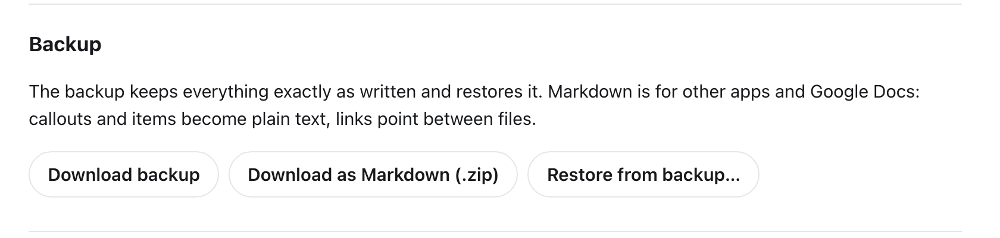

## Deploy by hand

If you’d rather not use the button, or want to work on the code:

```sh
git clone https://github.com/tyler-class/Nitrogen.git && cd Nitrogen
npm install
npx wrangler login
npm run deploy
npx wrangler secret put APP_PASSWORD
```

Wrangler creates the D1 database, R2 bucket and KV namespace on the first deploy.

How the button, Workers Builds and the update workflow fit together:
[docs/deploy-and-updates.md](docs/deploy-and-updates.md).

## Local development

```sh
npm install
cp .dev.vars.example .dev.vars    # then set APP_PASSWORD
npm run db:migrate:local
npm run dev
```

Local dev uses keyword search (AI Search only runs on Cloudflare). To use your deployed AI Search
index locally, sign in with `npx wrangler login` and run `N2_REMOTE=1 npm run dev`.

| Script                       | What it does                                       |
| ---------------------------- | -------------------------------------------------- |
| `npm run dev`                | Vite dev server with the Worker running in workerd |
| `npm run build` / `preview`  | Production build / serve the build locally         |
| `npm test`                   | Unit tests and Workers-runtime API and MCP tests   |
| `npm run typecheck` / `lint` | TypeScript, ESLint and Prettier                    |
| `npm run deploy`             | Build, migrate the remote database, then deploy    |
| `npm run release`            | Migrate, then deploy (the Workers Builds command)  |

### How it’s built

- **Cloudflare Workers** with static assets. **Hono** serves `/api`; **D1** stores pages, the tree,
  history, links and the FTS5 keyword index; **R2** stores images (served at `/files/…` to signed-in
  users); **AI Search** provides semantic search; **KV** holds MCP OAuth grants.
- **React**, **TypeScript**, **Vite**, **TanStack Query**, **React Router** and **CodeMirror 6**,
  installable as a PWA.
- See [docs/ARCHITECTURE.md](docs/ARCHITECTURE.md) and [docs/DECISIONS.md](docs/DECISIONS.md).

## Support

Nitrogen is free and built by [Tyler Class](https://tylerclass.net). If you want to say thank you, coffee is my love language: [ko-fi.com/tylerclass](https://ko-fi.com/tylerclass) ☕

## License

[MIT](LICENSE)
